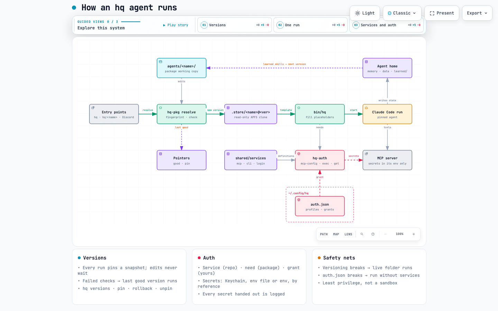

# hq

Persistent specialist agents you can call from any repo. Each has its own skills and layered memory, and each is its
own git repo: install one from a GitHub link, change it, roll it back, share it or keep it private. Persistent means
durable identity and memory, not a long-running process: every call is a fresh session that picks up where the last
one left off.

## What makes it different
- **An agent is a folder on your computer, not a container or a hosted service.** A personal agent's abilities come
  from its machine: your browser profile, Keychain, GPU, local models, the CLIs you're logged in to. hq runs agents
  where those are, as plain Claude Code sessions, instead of rebuilding them somewhere else.
- **An agent is a git repo.** Install one from a GitHub link, change it however you like, and every version that
  passes its checks is committed. Roll back to any of them, share one, or keep it private. The agent learning a new
  skill is a change like any other: versioned, and undone the same way.
- **What it is and what it knows are kept apart.** The package (instructions, skills, tools) is shareable; memory
  and data live in your private state folder. Sharing an agent never shares your life, and upgrading one never
  touches its memory.
- **It needs no accounts.** An agent says which services it needs; you grant it an account. Secrets reach only the
  process that uses them. Two people can run the same agent with their own logins.
- **Specialists stay cheap.** Each capability belongs to one agent and loads only when that agent runs, so your main
  session sees one line per agent, and adding agents doesn't make every session heavier.

## Core idea: simple, stable, scalable
- **Simple.** An agent is markdown plus a few tools in a folder. The kernel is a handful of scripts (bash and Python
  standard library) on top of Claude Code and git: no server, database, daemon or container. If you can read a
  folder, you can read an agent.
- **Stable.** Every run is pinned to a read-only snapshot, so an agent can change mid-session without breaking a run
  in progress. A version that fails its checks never runs (the last good one does), every good version is in git,
  and a missing secret or broken service costs a run that service, never the run itself.
- **Scalable.** Adding an agent is adding a repo; nothing central grows. Because each agent loads only its own
  skills, context stays flat as you add more. Agents travel by GitHub link and are found by topic, so going from
  one person's agents to everyone's is sharing a repo, and serving many people is one machine per person running hq,
  not a platform.

How it fits together and where it's going: [docs/architecture.md](docs/architecture.md); one run, drawn:
[docs/how-hq-runs.html](docs/how-hq-runs.html).

<picture>
  <source media="(prefers-color-scheme: dark)" srcset="docs/img/how-hq-runs-dark.png">
  
</picture>

```
git clone https://github.com/Ying-Kai-Liao/hq ~/Workspace/hq && ~/Workspace/hq/install.sh
hq install <owner>/<repo>            # an agent: any GitHub repo with an agent.md at its root
hq-new <name> "<description>"        # or start your own
```
This repo is the kernel only: no agents ship with it. `install.sh` links the `hq` CLI and installs the Claude Code
adapter plugin (`adapters/claude-code`, served by this repo's own marketplace). Then, in any Claude Code session:
"have the designer critique this page", `/hq branding <task>`, or the `mcp__hq__invoke` tool. Agents appear as
`hq:<name>`; your main session only sees one line per specialist, and their skills load only when they're called. Or
run one directly in a terminal: `hq branding`.

The plugin reads the installed agents at session start: edit an `agent.md` or `PROTOCOL.md` and the next session has it.
On every spawn it resolves the project, puts it and the agent's long-term memory in front of the task, and when the
agent stops without writing its session file, asks it to once.

## Agents
Each agent is a git repo, checked out in the **agents folder** (`$HQ_AGENTS`, default `~/.hq/packages/<name>/`).
Whoever changes it (you, a code agent, or the agent itself writing a learned skill) changes that checkout; every
version that passes its checks is committed there automatically, so its history is the agent's history.
```
hq install <owner>/<repo>                      # or a github.com URL; .../tree/<ref>/<folder> for one agent in a bigger repo
hq install <link> --as <name>                  # under another name
hq update <agent>|--all                        # pull upstream (fast-forward only; your edits are never overwritten)
hq history <agent>                             # every committed version
hq restore <agent> <commit>                    # bring one back, as a new commit (undo with another restore)
hq share <agent> [--public]                    # put it on GitHub as <you>/hq-agent-<name>, private unless --public
hq search [words] [--mine]                     # find agents: GitHub repos tagged hq-agent (yours incl. private, anyone's public)
hq push <agent>|--all                          # push committed versions (hq-state commit does this for every agent)
```
`--public` runs the privacy check over the package *and its whole history* and refuses while either names you: a
public repo shows every old commit. An agent installed from someone else keeps their repo as `upstream`; `hq share`
makes yours `origin`, so `hq update` still pulls their changes.

## Repos, and where each change goes
Agent repos carry the GitHub topic `hq-agent` (`hq share` adds it) and the kernel `hq`, so they group without an
organization: `hq search --mine` lists yours, private ones included, and public agents from anyone show up in
`hq search` and at github.com/topics/hq-agent. To publish an agent of your own made outside `hq share`, add the topic.

Running hq takes **2 + N repos**: this kernel, your state repo, and one per agent you've shared. Agents installed
from someone else stay in their repo (+0 until you `hq share` your own copy); third-party skills are fetched from
their authors' repos (+0). Several agents can share one repo, installed by folder (`hq install
<owner>/<repo>/tree/main/<folder>`), though `hq share` makes one repo per agent.

| Repo | Holds | Visibility |
|---|---|---|
| `hq` (this one) | the kernel: `bin/`, `shared/PROTOCOL.md`, `shared/services/`, the plugin | public |
| `<you>/hq-state`, cloned to `~/.hq` | memory, data (as text dumps), `user.md`, projects, `agents.json` | **private** |
| `<you>/hq-agent-<name>`, in `~/.hq/packages/<name>` | one agent: `agent.md`, settings, skills, tools, learned skills | private unless you share it |

| You change | It goes to | Saved by |
|---|---|---|
| An agent (you edit it, ask it to change, or it learns a skill) | that agent's repo | committed automatically on its next run; pushed by `hq-state commit` or `hq push <name>` |
| A new agent (`hq-new`, or ask the instructor) | a new local repo in the agents folder | `hq share <name>` once creates its GitHub repo; from then on as above |
| The kernel or `PROTOCOL.md` | this repo | a normal commit and push; it's public, so `hq-pkg check --share` first |
| A service (`shared/services/<name>.json`) | this repo | as the kernel; it names its secrets, never their values |
| Memory and data | the state repo | `hq-state commit` |

A kernel change reaches every agent on its next run without touching their repos. An agent that starts to `need:` a
new service only passes its checks where that service exists, so push the service with the kernel.

**On a new Mac**, clone the state repo first (it lists your agents), then the kernel:
```
git clone https://github.com/<you>/hq-state ~/.hq
git clone https://github.com/Ying-Kai-Liao/hq ~/Workspace/hq && ~/Workspace/hq/install.sh   # reinstalls agents.json's agents
```

**Not in any repo**, so redo them by hand on a new Mac:
- an agent you never shared: `agents.json` records it without a link, so `install.sh` skips it;
- grants and profiles (`~/.config/hq/auth.json`), secrets (Keychain), `~/.config/hq/env`: `hq auth grant`, `hq auth set`;
- scheduled jobs (`~/Library/LaunchAgents/dev.hq.*.plist`): each tool's `install` command, or `hq-bridge --install`.

## Layout
The repo holds the kernel. Agents live in the agents folder, each its own repo; what the agents and you accumulate
(memory, data) lives in the **state folder**, `$HQ_STATE` or `~/.hq` (its own private git repo; `hq-state commit`).
```
install.sh                 links ~/.local/bin/hq and installs the Claude Code plugin
adapters/claude-code/      the Claude Code adapter (plugin); .claude-plugin/marketplace.json serves it
bin/project-id             resolves the current directory to a project; --list, --register
bin/hq                     run an agent directly: hq ls · hq <agent> [-p ID] [task] · --print
bin/hq-pkg                 agents: install, update, history, restore, share; versions: resolve (pin a run), pin, check
bin/hq-new                 scaffold a new agent as its own repo
bin/hq-auth                shared services: which agent may use which, as which account
bin/hq-state               the state folder's git repo: path, dump (sqlite as text), commit
shared/
  PROTOCOL.md              memory rules, appended to every agent's prompt
  services/<name>.json     shared services (MCP servers, APIs, logins): how to start them, which secrets by name

~/.hq/packages/            the agents folder ($HQ_AGENTS; git-ignored by the state repo)
  <name>/                  one agent, its own git repo
    agent.md               identity, how it works, skill index
    capabilities.yaml      tools and data sources it may use, by name only — never credentials
    settings.json          Claude Code settings merged over your global ones for hq runs: model, plugins, permissions
    skills/ tools/         its skills (read on demand) and the tools they drive
    skills/learned/        skills it wrote itself; versioned and shared with it
  .store/                  snapshots, one per version (same disk as the agents, so each is an APFS clone)

~/.hq/                     the state folder
  projects.json            project IDs → the git remotes / paths that belong to them
  shared/user.md           about the user (incl. visual taste), read by every agent
  shared/projects/<id>/    codebase.md (shared project map) + decisions.md (append-only log)
  agents/<name>/
    memory/MEMORY.md         long-term index (auto-loaded on every call)
    memory/projects/<id>.md  its notes on one project
    memory/sessions/<id>.md  where the last call on that project left off
    skills/learned/          private skills, never shared (hq-pkg promote <agent> <skill> moves one into the agent)
    data/                    its databases; committed as text dumps (<name>.sql), not binaries
```

## Versions
An agent's package is its folder in the agents folder; its state is in the state folder. Every run is pinned to a snapshot of
it, so agents can be upgraded at any time, by anyone (you, the agent writing a learned skill, a code agent like this
one), without waiting for running sessions:

- On each run `bin/hq-pkg` fingerprints the package. Unchanged: run the existing snapshot. Changed: check it (frontmatter,
  JSON, skills named in agent.md exist, needed services exist), then snapshot it into `.store/<name>@<version>/` as
  an APFS clone, and commit it to the agent's repo. Prompt and settings stay templates in the snapshot; placeholders
  are filled at run time. Running sessions keep the snapshot they started on.
- A version that fails its checks is never used; the last good one runs and the reason is printed. Checks:
  frontmatter, JSON, unknown `{{PLACEHOLDERS}}`, skills named in agent.md exist, needed services exist.
- Multi-file edits: `touch <agents folder>/<name>/.editing` first and delete it when done; runs keep the last good version
  meanwhile, so nobody gets a half-edited agent. A marker older than an hour is ignored.
- If versioning itself fails, the run uses the live folder and says so, rather than not running.
- `hq versions <name>` lists them; `hq rollback <name>` pins the previous one; `hq pin <name> <version>`;
  `hq unpin <name>` follows edits again. Old snapshots are removed after two days unless pinned, good or running;
  the commits stay, and `hq restore` brings any of them back.
- `hq:<name>` subagents are pinned per Claude Code session (the adapter resolves every agent at session start).

In prompts and settings: `{{AGENT_DIR}}` is the pinned package (read skills and run tools from it),
`{{PACKAGE}}` the agent's live folder (where it writes learned skills), `{{AGENTS}}` the agents folder (another
agent's tools: `{{AGENTS}}/house/tools/house.py`), `{{HOME_DIR}}` the agent's folder in the state folder (memory, data), `{{HOME_REAL}}` the same with
symlinks resolved (use it in permission rules: Claude Code matches resolved paths), `{{STATE}}` the state folder,
`{{HQ}}` the kernel repo, `{{USER_HOME}}` your home folder (for permission rules, instead of `/Users/<name>`). Tools find their data through the snapshot's `.home` file; run from the live package (launchd,
another agent), they use `$HQ_STATE/agents/<name>`, else `~/.hq/agents/<name>`.

## Third-party skills
Skills from public GitHub repos are linked, not copied. An agent's `skills.json` names each one's `repo`, `path`
and `ref` (a full commit sha) and its licence; `hq-pkg fetch <agent>|--all` downloads just those folders into
`skills/<name>/` (a shallow, sparse fetch: seconds, however big the repo), where they're git-ignored and carry a
`.source` file. `install.sh` fetches every agent's; a run fetches anything missing on first use. A package whose
linked skills aren't fetched fails its checks, so the last good version runs. To upgrade one, change its `ref`.
Notes of your own about a linked skill go next to it (image's `skills/anatomy-hq.md`), never inside it. A skill
for your own install only (one you can't or won't share) goes in the agent's `skills/learned/` in the state folder,
not the package, listed in its MEMORY.md.

## Services and auth
Three layers, so sharing an agent never shares an account:

| Layer | Where | Says |
|---|---|---|
| Service | `shared/services/<name>.json` (repo) | what it is (`mcp`, `cli`, `login`), how to start it, which env vars it needs |
| Need | `needs: [...]` in the agent's `capabilities.yaml` (package) | what the agent asks for |
| Grant | `~/.config/hq/auth.json` (yours, never in the repo) | profiles (an account: where each secret comes from) and grants (agent → service → profile) |

```
hq auth                                   # who needs what, who has what, whether each secret resolves
hq auth grant personal notion notion/library
hq auth set notion/library NOTION_API_KEY # store in Keychain (prompts), point the profile at it
```
`bin/hq` starts only the MCP services an agent needs *and* is granted; secrets are resolved when the server starts
(`hq-auth exec`) and exist only in that process, never in a config file or the agent's environment. A cli tool asks
`hq-auth get --for <agent>`, which refuses agents without a grant. Every secret handed out is logged (time,
service, profile, who asked, who was running; never the value) to `~/.config/hq/auth.log`. A broken `auth.json`
or a secret that doesn't resolve costs the agent that service for the run, never the run itself. Profile sources: `keychain:SVC#ACCOUNT`,
`env-file:PATH#VAR`, `env:VAR`. This keeps cooperating agents to least privilege; it isn't a sandbox (an agent with
a shell can read what your user can). `hq:<name>` subagents run inside the calling session and share its MCP
servers; give an agent with its own credentials a full `hq <name>` run when it needs them.

## Settings
`hq <agent>` runs a normal Claude Code session: your global settings, hooks, skills and the repo's own config all
load. The agent's `settings.json` (rendered into the snapshot) is merged on top to narrow it per agent: all agents turn off Claude Code's own auto
memory (hq memory replaces it) and the flow plugin (flow calls agents, not the other way round); designer links impeccable as a
pinned skill, devops keeps vercel; finance and personal can't edit `~/.hermes`. Subagent calls (`hq:<name>` inside a
session) use that session's settings instead.

**Model and effort** live in `agent.md`'s frontmatter (`model: sonnet`, `effort: low|medium|high|xhigh|max`), so they
apply to both `hq <agent>` runs and `hq:<name>` subagents and change with the agent's version. Override one run with
`hq <agent> -m MODEL -e EFFORT` (or `HQ_MODEL` / `HQ_EFFORT`); leave a field out to use your global setting.

## Cost
`bin/hq-cost` keeps every Claude Code request's cost (list API prices) in `~/.config/hq/cost.db`, so it outlives
transcript cleanup. Each session `hq` starts is tagged with the agent, package version, model, effort and caller
(terminal or discord); `hq:<name>` subagents are recognised by their type. `hq cost agents [today|week|month|all]`
compares agents; `hq cost agent video` shows one agent by day, by version/model/effort and its costliest runs;
`hq-cost csv` exports every request with its agent for analysis elsewhere.

## Memory layers
1. **Identity and skills:** `agent.md` + `skills/` (including the ones it learned) + `capabilities.yaml`.
2. **Long-term:** `memory/MEMORY.md` and topic files: the craft, lessons. The user lives in
   `shared/user.md`. All of these are in the state folder.
3. **Project:** `shared/projects/<id>/` (shared by all agents) + `memory/projects/<id>.md` (private). The codebase map
   records its commit, so agents only re-read what changed since.
4. **Session:** the live conversation, plus `memory/sessions/<id>.md` across calls.

Memory is the agent's perspective, not the truth: code, specs and live data win. Current facts (expenses, calendar,
infrastructure) are read from their source every time, never from memory.

## Projects
A project is a named thing an agent builds a relationship with; git remotes and paths are aliases that point to it
(`projects.json` in the state folder). One project can span several repos and survive renames: `acme` (formerly Widget) covers both
`acme-web` and `widget-app`. Remotes work on every device; paths are machine-specific.

How an agent finds its project, first match wins:
1. **Given:** `hq <agent> -p acme`, or the project named in the request.
2. **Matched:** `bin/project-id` finds the current directory's remote or path in `projects.json`.
3. **Default:** non-code agents use a fixed ID outside a repo (`finance`, `personal-places`, …).
4. **None:** no project memory. Nothing is registered automatically; the agent asks you for a name first.

```
bin/project-id                    # ID for the current directory, or nothing
bin/project-id --list             # all projects and their aliases
bin/project-id --register acme [dir]   # add dir's remote (or path) to a project
```

## Adding an agent
`bin/hq-new <name> "<description>"`, or ask the instructor. It creates the agent in the agents folder as its own git
repo (`agent.md`, `capabilities.yaml` with `needs:`, `settings.json`) and its memory folders in the state folder; put
its skills in `skills/`. New sessions pick it up; `hq share <name>` puts it on GitHub.

## Notes
- The state folder holds personal data: keep its remote **private**. `hq-state commit` commits and pushes it, then
  pushes every agent's repo.
- Packages carry no personal details: those go in the state folder. `hq-pkg check --share` flags home paths, email
  addresses and the words in `~/.hq/private-words`.
- Status: early, built for one person's Mac. macOS only (APFS clones, Keychain, launchd); needs Claude Code, git
  and python3 (gh to share agents, uv for the Discord bridge).
- MIT licence (LICENSE). Linked skills keep their own licences (each agent's skills.json).
- Design working files live outside the repo in `~/Workspace/design/<project-id>/`; sync that folder separately.
